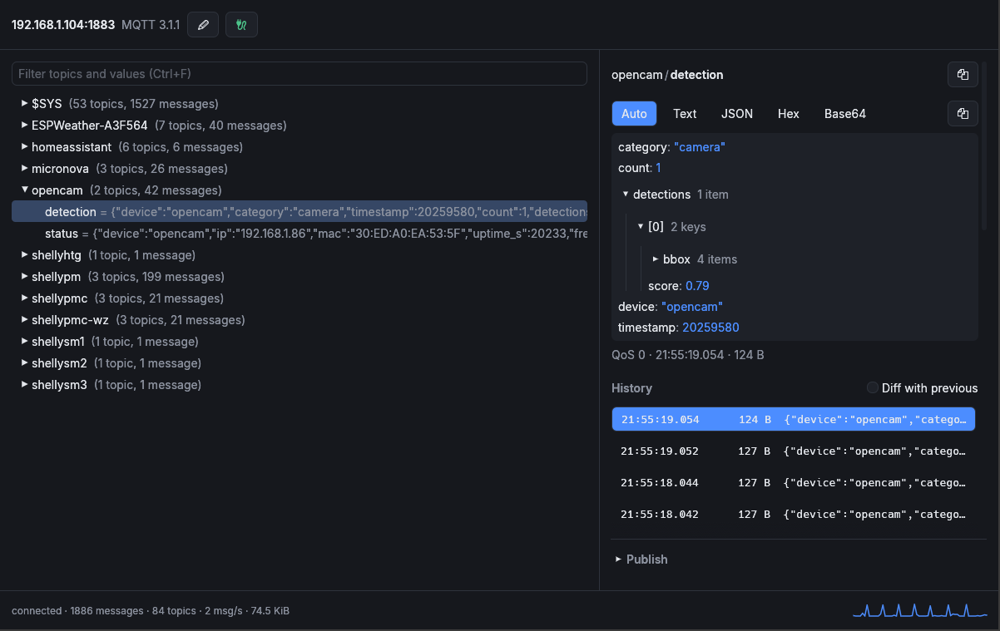

# rstmqtt

A simple but versatile Rust application for debugging MQTT, featuring:

- Live topic tree with filtering and message counters
- Message inspection, history and diffs
- Publishing over MQTT 3.1.1 and 5

## Install

```sh
make all                           # dependencies, then build and install
make install                       # build and install to ~/.local/bin
make install PREFIX=/usr/local     # ... to /usr/local/bin instead
make uninstall                     # remove the binary and saved settings
make run                           # run the viewer from the source tree
```

Or build directly with Cargo:

```sh
cargo build --release
```

Rust and Cargo are required. On Linux, `make all` installs missing display libraries through the system package manager and may prompt for `sudo` access.

## Viewer



Use the edit button in the top bar to configure the broker and subscriptions, then
click `Connect`. Defaults are `localhost:1883`, MQTT 3.1.1, and subscriptions to
`#` and `$SYS/#` at QoS 0.

- Topic tree with value previews, change highlights and message/topic counters.
- Filter topics and latest values with `Ctrl+F`; use arrow keys to navigate and
  `Enter` to expand or collapse.
- Payload views: Auto, Text, JSON, Hex and Base64. JSON objects and arrays expand
  into a tree; right-click to copy a path or value.
- Last 100 messages per topic, with a diff against the previous message.
- Message details: receipt time, size, QoS, retained flag and MQTT 5 properties.
- Publish with QoS and retain options, JSON formatting and recent-message reuse.
  MQTT 5 also supports content type and user properties.
- Clear retained messages on a topic or across a subtree from the context menu.
- Copy the displayed value with `Ctrl+C`, or the topic with `Ctrl+Shift+C`.

Connection settings, payload view, publish history and window geometry are remembered across restarts.
Passwords stay in memory until the app closes; received message history is kept only for the current session.

## Credits

This application is inspired by the wonderful [MQTT Explorer](https://mqtt-explorer.com/).
The idea of a tree-based message view and the principle application layout originate from "MQTT Explorer". 
